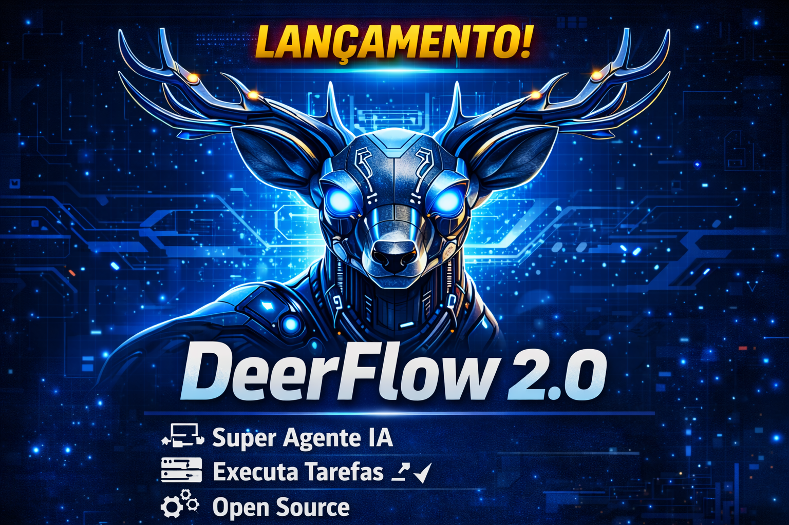

# Curso: DeerFlow 2.0 ê¢â‚¬â€ do bêƒÂ¡sico ao avanêƒÂ§ado

<div align="center">
  
  <p><strong>Arckhé AI</strong></p>
</div>




RepositêƒÂ³rio de conteêƒÂºdo do curso sobre **DeerFlow 2.0**, o super agent harness open-source da ByteDance.

O curso cobre trêƒÂªs frentes:

1. **Track 1 ê¢â‚¬â€ Fundamentos**: o que êƒÂ©, como instalar, como usar no dia a dia (pêƒÂºblico: devs curiosos, PMs têƒÂ©cnicos, pesquisadores).
2. **Track 2 ê¢â‚¬â€ AvanêƒÂ§ado**: arquitetura interna, criaêƒÂ§êƒÂ£o de skills, sub-agents, MCP servers, embedding, contribuiêƒÂ§êƒÂ£o upstream (pêƒÂºblico: engenheiros de IA, platform engineers).
3. **Comparativo**: DeerFlow vs. Claude Code vs. Antigravity ê¢â‚¬â€ quando usar o quêƒÂª.

## Estrutura do repositêƒÂ³rio

```
deerflow/
ê¢â€Å“ê¢â€â‚¬ê¢â€â‚¬ docs/
ê¢â€â€š   ê¢â€â€ê¢â€â‚¬ê¢â€â‚¬ plano-do-curso.md           # Plano mestre do curso (mêƒÂ³dulos, labs, entregêƒÂ¡veis)
ê¢â€Å“ê¢â€â‚¬ê¢â€â‚¬ track-1-fundamentos/            # Material do Track 1 (a produzir)
ê¢â€â€š   ê¢â€â€ê¢â€â‚¬ê¢â€â‚¬ README.md
ê¢â€Å“ê¢â€â‚¬ê¢â€â‚¬ track-2-avancado/               # Material do Track 2 (a produzir)
ê¢â€â€š   ê¢â€â€ê¢â€â‚¬ê¢â€â‚¬ README.md
ê¢â€â€ê¢â€â‚¬ê¢â€â‚¬ comparativo/                    # MêƒÂ³dulo comparativo (a produzir)
    ê¢â€â€ê¢â€â‚¬ê¢â€â‚¬ README.md
```

## Como usar este repo

- O arquivo `docs/plano-do-curso.md` êƒÂ© o ponto de partida. Ele contêƒÂ©m o êƒÂ­ndice completo, objetivos, labs e entregêƒÂ¡veis de cada mêƒÂ³dulo.
- Cada track tem seu prêƒÂ³prio diretêƒÂ³rio com o conteêƒÂºdo das aulas (roteiros, slides-chave, cêƒÂ³digo dos labs).
- O diretêƒÂ³rio `comparativo/` hospeda o material transversal de comparaêƒÂ§êƒÂ£o entre plataformas.

## Status

Plano do curso salvo. ConteêƒÂºdo dos mêƒÂ³dulos **pendente** de decisêƒÂµes sobre:

- Formato final (vêƒÂ­deo, texto, HTML interativo, LMSê¢â‚¬Â¦)
- Idioma
- DuraêƒÂ§êƒÂ£o-alvo
- Profundidade dos labs
- NêƒÂ­vel de prêƒÂ©-requisito do Track 2

Ver o final de `docs/plano-do-curso.md` para o checklist de decisêƒÂµes em aberto.

---

<div align="center">
  
  <p><strong>Arckhé AI</strong></p>
</div>